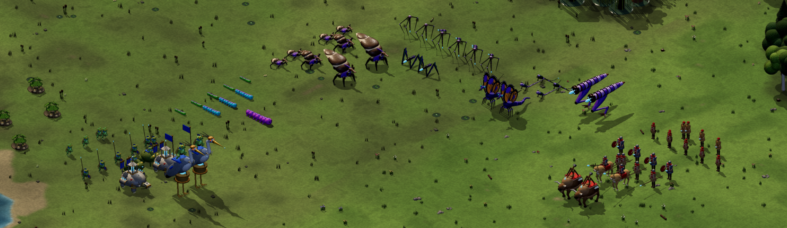
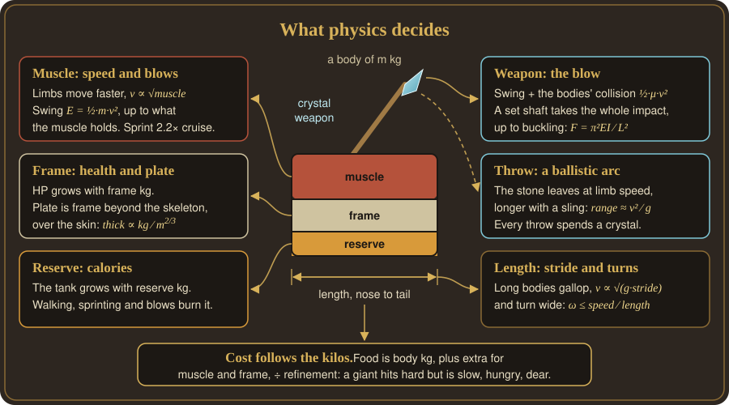
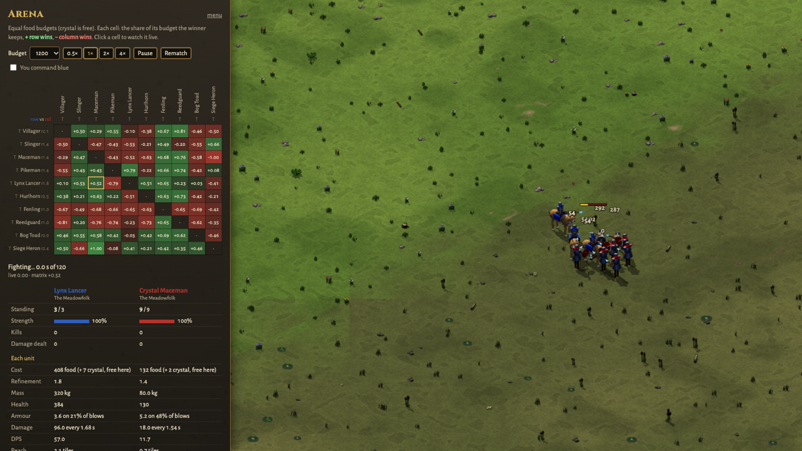
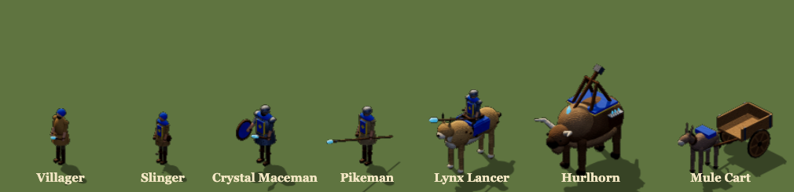
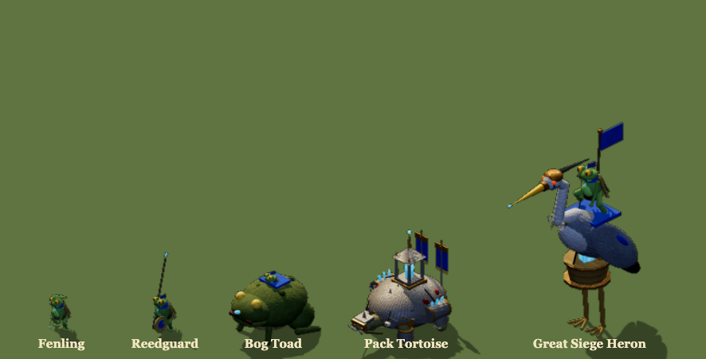

<h1 align="center">VibeCraft</h1>

<p align="center"><b>A real-time strategy game in your browser.<br>Play one of three armies, or make your own with an AI.</b></p>

<p align="center">
  <a href="http://mcscope.com/game/vibecraft/"><b>▶ Play it now</b></a> ·
  <a href="http://mcscope.com/game/vibecraft/make.html">Make your army</a> ·
  <a href="#game-modes">Game modes</a> ·
  <a href="#play-online">Online</a> ·
  <a href="#development">Development</a>
</p>



## Quick start

**To play:** open **[mcscope.com/game/vibecraft](http://mcscope.com/game/vibecraft/)**. Pick the Meadowfolk and press **Tutorial**.

**To run your own copy** (you need [Node.js](https://nodejs.org) and git):

```sh
git clone https://github.com/mcscope/Vibecraft.git
cd Vibecraft
npm install
npm run dev
```

Then open the address it prints.

---

## What makes it different

### You can bring your own army

Play a shipped army, or make one. You describe your people in code, usually by chatting with an AI coding assistant: their units, buildings, techs, art, homeworld and wildlife. Then take them online. Your army travels to your opponent as data, and their game checks it against the rules.

### Physics sets every stat

You design **bodies**. The game works out each unit's health, damage, speed and cost. A body is:

- its mass;
- how that mass splits between muscle, frame (bone, shell, plate) and reserve;
- the crystal weapon it swings or throws.



Counters come from the same physics. Pikes counter chargers, and chargers run down infantry. The **Arena** scores every matchup.



### Resources are physical

| Resource | How it works |
|---|---|
| **Calories** | Every unit burns calories, and a bigger body carries more. Walking drains them slowly; sprinting and fighting drain them fast. A unit on empty is slow and too weak to fight until it eats. Supply decides how far your army can reach. |
| **Crystals** | Crystal is ammo. A striker keeps the crystal on its weapon. A thrower spends one each throw, and spent stones lie where they land for anyone to pick up. Ammo bearers act as mobile restock points. |
| **Carts** | Each building has its own stock. Carts and haulers move resources to where they're needed, most urgent first. Build close together to train faster. |

---

## The armies

| Army | Difficulty | Who they are | How they play |
|---|---|---|---|
| **The Meadowfolk** | Simple | The most traditional army: farmers and knights. | They fight with lance, mace, cavalry and siege. Automatic carts simplify resource management, so they play most like a traditional RTS. |
| **The Fenfolk** | Medium | Frog-folk from deep in the marsh. | Large bog creatures, herons and toads, reinforce armies of little fenling worker-fighters. Expect heavy micro, and a tricky balance of economy and military. |
| **The Wildwelds** | Complex | A living swarm of insectile larvae, who evolve and grow into ferocious beasts. | Units make units: mothers lay eggs, and larvae change in cocoons into fighters, walls and towers. It's a production system unique in an RTS, with a steep learning curve. |

Each roster shows every unit to scale.





---

## Game modes

| Mode | What you do |
|---|---|
| **Tutorial** | Play a track of short lessons for your army: calories, crystals, supply, charges, groupings, and that army's speciality. Each lesson has a checklist that ticks itself off as you play. |
| **Skirmish** | Build a base and fight the computer. |
| **Pitched Battle** | Draft an army to a food budget, place it on a battlefield, and fight with what you drafted. |
| **Online** | Play against a friend, one on one. |
| **Spectate** | Watch two computer players fight. |
| **Arena** | Watch any two units fight on an equal budget, and see every matchup scored. Tick *You command blue* to fight it yourself. |
| **Proving Grounds** | Test a full army on training dummies and a target fort. |
| **Codex** / **Unit Lab** | Look up every unit, building and tech, and see how each body turns into stats. |

### Maps

| Map | What it's like |
|---|---|
| **Woodlands** | Ponds and thick woods shape the lanes. |
| **Steppe** | Open ground, so armies meet early. After Age of Empires II's Arabia. |
| **Water Donut** | A ring of water around a rich island, crossed by two fords. |
| **Cliff Maze** | Rooms on terraces, joined by ramps. |
| **Sunken Temple** | High plateau bases with one ramp each. After StarCraft's Lost Temple. |

Pick a map in the menu. Online, the host picks.

**High ground** matters on Cliff Maze and Sunken Temple. Units up high see further, and the crystals they throw down hit harder.

### Computer players

- **Easy** reacts slowly and attacks in small waves.
- **Hard** (the default) thinks faster, runs a tighter economy, scouts, and counters what it has seen. It attacks once its army is stronger, focuses fire and pulls back hurt units.
- **Both play fair.** They see only what their own units see, and use the same rules and commands as you.

### Start from a link

Put the setup in the address, for example:

```
?mode=skirmish&you=fenfolk&foe=meadowfolk&map=cliff-maze&seed=5&ai=easy
```

---

## Make your own army

You make an army in your own copy of the game (see [Quick start](#quick-start)). The in-game guide, **[Make your army](http://mcscope.com/game/vibecraft/make.html)**, walks you through it. In short:

1. **Dream up your people.** Decide where they live, what they eat and how they fight. Pick a theme and one or two signature ideas. [DESIGN_SPACE.md](DESIGN_SPACE.md) lists abilities waiting for a first army to use them.
2. **Copy a faction.** Copy `src/factions/fenfolk/` (or `meadowfolk/`) to `src/factions/<yours>/`. Give it a new `id` and `name`.
3. **Register it.** Add it to `PLAYABLE` in `src/factions/index.ts`, and to the Codex in `src/codex.ts`.
4. **Shape the bodies,** using the fields below. The Codex and Unit Lab update as you change them.
5. **Draw them.** Each unit and building has a `model(builder, pose)` made of boxes, spheres, limbs and joints. The game bakes each model into lit sprites.
6. **Bring your land.** `homeworld.ts` sets the look of your half of the map. `wildlife.ts` lists the animals that roam it.
7. **Test it.** Try it in the Arena, Proving Grounds and Skirmish. The computer player reads your buildings, so it can play any army. `npm test` checks your army against the rules.

### A unit's body

| Field | What it sets |
|---|---|
| `mass` | Weight in kg. A bigger body is stronger, hungrier, slower to turn and more expensive. |
| `physique: { muscle, frame, reserve }` | How the mass splits. Muscle drives speed and blows, frame gives health and armour, and reserve stores calories. |
| `attack: { style, crystalMass }` | `'strike'` or `'throw'`, and how many kg of crystal it swings or throws. Throwers also carry `ammo`. |
| `attack.shaft` | Metres of spear, for strikers. It adds reach and counters chargers. |
| `attack.sidearm` | A hand weapon worn beside a spear, for close fighting and to the sides. |
| `attack.sling` | Metres of sling cord, for throwers. It throws light stones faster. |
| `length` | Metres from nose to tail. Long bodies gallop and turn in wide arcs. |
| `refinement` | Makes the unit cheaper to train. Buildings and techs raise it. |

`src/factions/types.ts` documents every field.

### Three rules

- **Keep a faction self-contained.** It imports its own files, plus shared helpers from `src/kits/` and `src/biomes/`.
- **Get strength from the body.** To make a unit stronger, give it a bigger body or more refinement. The physics sets the price.
- **Add new behaviour as an engine ability.** Flying, burrowing or healing goes in `src/sim/abilities/` as a generic ability any faction can switch on. Give it a validation check and a Codex line.

---

## Play online

Online games are one on one. Each player runs their own copy of the game with their own army. When the match starts, your army travels to your opponent as data, so each of you needs only your own code.

1. **Pick a relay.** A relay passes moves between players. The hosted game uses `ws://mcscope.com:5190`. To run your own, use `npm run relay` (port 5190). For play over the internet, run it on a public machine. A game served over https needs a `wss://` relay.
2. **Join.** Each player opens **Online**. Enter the relay address, the same room code, a name and an army. On a local network, `npm run dev -- --host` lets others open your copy.
3. **Start.** The first player in the room hosts and presses **Start**.

Both players need the same version of the game, so both follow identical rules.

### How it stays fair

- **Your opponent's game works out your stats.** Every unit costs what its body is worth.
- **Both players start from the same pool of resources** (`START_POOL`). Your starting base and workers come out of it, so a grand base means a lean start.
- **The game limits the few things outside physics,** like how much wildlife roams your half.

The rules live in `src/sim/fairness.ts`.

---

## Development

### Commands

| Command | What it does |
|---|---|
| `npm run dev` | Runs the game locally, with live reload. |
| `npm test` | Runs the simulation tests. |
| `npm run typecheck` | Checks the types. |
| `npm run arena` | Prints the unit matchup table. Add `flat` to compare bodies at refinement 1. |
| `npm run aimatch` | Plays the computer players against each other. |
| `npm run aibatch` | Plays a batch of computer games and reports win rates, armies, idle workers and unused stock. |
| `npm run relay` | Runs a relay for online play. |
| `npm run build` | Makes a production build with the art pre-baked. |
| `npm run build:fast` | Makes a production build that bakes art in the browser. |
| `npm run sprites` | Checks the pre-baked armies against the [sprite budget](#sprite-budget). |

### Pre-baked art

The game turns its 3D models into sprites in your browser, and that takes time. `npm run build` bakes the shipped armies ahead of time, in every team colour, into `dist/baked/`. The hosted game loads those files. The step takes several minutes and needs Chrome. Your own armies bake in the browser, and `npm run dev` always bakes live, so model changes show up at once.

### Sprite budget

Every baked pixel is packed and sent to the graphics card before a game starts. So each army has a budget.

| What | Budget (sprite pixels, one team's colours) |
|---|---|
| An army | 64 million |
| One unit or building | 40 million |

`npm run sprites` prints each pre-baked army's table, unit by unit, and flags anything over. `npm run build` prints it too. The numbers live in `scripts/spriteBudget.mjs`.

The baker already stores a repeated frame once, and bakes a flier's shadows apart from its body. Every sprite bakes at full resolution. To bring a big unit inside the budget, set these in its faction's `art.ts` (`UnitBakeOptions` in `src/kits/bake3d/baker.ts`):

| Option | When to use it |
|---|---|
| `without: ['gather', 'eat']` | Its model draws those as another animation. The game shows the fallback (usually idle). |
| `shadowApart: ['walk', 'attack']` | A tall or bounding body: frames holding the body and its long shadow are mostly empty. |
| `frames: { walk: 6 }` | A slow body that needs fewer frames. |

### Lockstep

Only commands travel between players. Each game then simulates the same world in step. So the simulation must give identical results everywhere: take all randomness from `world.rng`, and keep `Math.random` and the clock out of `src/sim/`. `tests/factions.test.ts` checks this by playing the same AI game twice and comparing the worlds throughout.

### Dev pages

| Address | What it shows |
|---|---|
| `?mode=sprites&unit=lynx&anim=attack&facing=3` | Every frame of one animation. |
| `?mode=sprites&faction=fenfolk` | A faction's roster. |
| `?mode=faceoff&you=fenfolk&foe=meadowfolk&third=wildwelds` | Two or three armies lined up, as in the header image. |
| `?mode=tutorial&track=wildwelds&lesson=1` | One lesson of an army's track. |
| `&sounddebug=1` (any mode) | The last sounds played, with ✕ to strike a bad clip. |
| `/voicelab/index.html` | Sorts recorded clips into unit voices and combat sounds. `npm run voices` imports the newest saved labels into `public/voices/`. |

### Layout

| Path | What's there |
|---|---|
| `src/factions/` | Factions: specs, models, homeworld, wildlife. `types.ts` documents every field. |
| `src/sim/` | The simulation: `world.ts`, `physics.ts` (body to stats), `logistics.ts`, `abilities/` |
| `src/ai/` | The computer player (`skirmishAI.ts`, with its Easy and Hard profiles), and how it uses abilities (`abilities.ts`) |
| `src/render/`, `src/ui/` | Drawing (PixiJS), the on-screen panels and input |
| `src/kits/bake3d/` | The three.js sprite baker |
| `src/art/` | The art contract, and loading pre-baked art |
| `src/net/` | Online play: lockstep, the relay client, and faction checks |
| `scripts/` | The relay server, the arena table, AI matches, pre-baking |
| `tests/` | Simulation tests |
