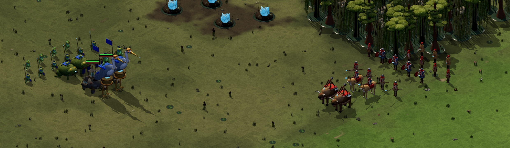
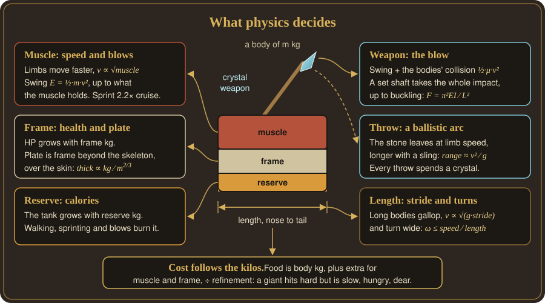

<h1 align="center">VibeCraft</h1>

<p align="center"><b>A real-time strategy game in your browser. Play a ready-made army, or build your own with an AI. Physics keeps every fight fair.</b></p>

<p align="center">
  <a href="http://mcscope.com/game/vibecraft/"><b>▶ Play it now</b></a> ·
  <a href="http://mcscope.com/game/vibecraft/make.html">Make your army</a> ·
  <a href="#playing">Playing</a> ·
  <a href="#playing-online">Online</a> ·
  <a href="#development">Development</a>
</p>



---

## What makes it different

### 🛡️ Bring your own army
Play one of the two shipped factions, or make your own. You describe your people in code, usually by chatting with an AI coding assistant ("vibecoding"). That covers their units, buildings, techs, art, homeworld and wildlife. Then take them online: your faction travels to your opponent as data, and their game checks it against the rules.

### ⚖️ Physics keeps it fair
You design **bodies**, and the engine works out each unit's health, damage, speed and cost. A body is:
- its mass;
- how that mass splits between muscle, frame (bone, shell, plate) and reserve;
- the crystal weapon it swings or throws.

The same rules apply to every body:



Counters come straight out of the physics: spears beat cavalry, and cavalry runs down infantry and throwers. The **Arena** scores every matchup.


### 🍖 Resources are physical: calories, crystals, carts
- **Calories.** Every unit carries a calorie tank, sized by its body. Walking, sprinting and fighting burn it. An empty unit slows down and can't fight until it eats. Units eat at buildings, from packs, or from food bearers. So supply decides how far your army can reach, and every charge has a cost.
- **Crystals.** Every weapon's tip is crystal. A striker keeps its crystal. A thrower spends one each throw, and the spent stones lie where they land for anyone to pick up. Towers and garrisons throw from their building's stock, and ammo bearers carry crystal into the field.
- **Carts.** Resources stay in the building that gathered them. Carts and hauling workers move them where they're needed, most urgent first. Where you build, and how you keep supplies flowing, is part of the strategy.

---

## The factions

Two factions ship with the game. Each roster below shows every unit to scale.

**The Meadowfolk:** farmers and knights of the green country. They fight with crystal maces, pikes, lancers on great lynxes, and the siege beast Hurlhorn.


**The Fenfolk:** frog-folk of the marsh. They fight with slingers, reed-spear guards, ridden bog toads, and a great siege heron.


---

## Playing

Play the shipped factions in your browser at **[mcscope.com/game/vibecraft](http://mcscope.com/game/vibecraft/)**. To play an army you made, run your own copy (see [Development](#development)).

| Mode | What you do |
|---|---|
| **Tutorial** | Seven hands-on lessons: calories, crystals, carts, Fen hauling, charges, groupings and birds. |
| **Skirmish** | Build an economy and fight the computer. |
| **Spectate** | Watch two computer players fight. |
| **Arena** | Watch any two units fight on an equal budget, and see every matchup scored. Tick *You command blue* to fight it yourself. |
| **Proving Grounds** | Command a full army against training dummies and a target fort. |
| **Online game** | Play a friend, one on one. |
| **Codex** / **Unit Lab** | Browse every faction's tech tree, and see how each body turns into stats. |

**Maps:** Woodlands, Steppe (after AoE2's Arabia), Water Donut, Cliff Maze, and Sunken Temple (after StarCraft's Lost Temple). Pick one in the menu. Online, the host picks.

**Computer players** come in **Easy** and **Hard** (the default). Both play fair: they see only what their own units see, and use the same rules and commands as you. Hard thinks faster, runs a tighter economy, scouts, and counters what it has seen. It attacks once its army is stronger, focuses fire and pulls back hurt units. Easy reacts slowly and attacks in small waves.

**Shortcut:** start a game straight from a URL, for example `?mode=skirmish&you=fenfolk&foe=meadowfolk&map=cliff-maze&seed=5&ai=easy`.

---

## Making your own army

You make an army in your own copy of the game, so start with [Development](#development). The in-game guide, **[Make your army](http://mcscope.com/game/vibecraft/make.html)**, walks players through it. In short:

1. **Dream up your people.** Where do they live, what do they eat, and how do they fight? Pick a theme and one or two signature ideas. [DESIGN_SPACE.md](DESIGN_SPACE.md) lists abilities waiting for a first faction to use them.
2. **Copy a faction.** Copy `src/factions/fenfolk/` (or `meadowfolk/`) to `src/factions/<yours>/`. Give it a new `id` and `name`.
3. **Register it.** Add it to `PLAYABLE` in `src/factions/index.ts`, and to the Codex in `src/codex.ts`.
4. **Shape the bodies,** using the fields below. The Codex and Unit Lab update as you change them.
5. **Draw them.** Each unit and building has a `model(builder, pose)` made of boxes, spheres, limbs and joints. The game bakes each model into lit sprites.
6. **Bring your land.** `homeworld.ts` sets the look of your half of the map. `wildlife.ts` lists the animals that roam it.
7. **Test it.** Try it in the Arena, Proving Grounds and Skirmish. The computer player reads your buildings, so it plays any faction. `npm test` checks your faction against the rules.

### A unit's body

| Field | What it sets |
|---|---|
| `mass` | Weight in kg. A bigger body is stronger, but hungrier, slower to turn and more expensive. |
| `physique: { muscle, frame, reserve }` | How the mass splits. Muscle drives speed and blows, frame gives health and armour, and reserve stores calories. |
| `attack: { style, crystalMass }` | `'strike'` or `'throw'`, and how many kg of crystal it swings or throws. Throwers also carry `ammo`. |
| `attack.shaft` | Metres of spear, for strikers. It adds reach and impales chargers. |
| `attack.sidearm` | A hand weapon worn beside a spear, for close fighting and to the sides. |
| `attack.sling` | Metres of sling cord, for throwers. It throws light stones faster. |
| `length` | Metres from nose to tail. Long bodies gallop and turn in wide arcs. |
| `refinement` | Makes the unit cheaper to train. Buildings and techs raise it. |

`src/factions/types.ts` documents every field.

### Rules of the road
- **Keep a faction self-contained.** It imports its own files, plus shared helpers from `src/kits/` and `src/biomes/`.
- **Get strength from the body.** To make a unit stronger, give it a bigger body or more refinement. The physics sets the price.
- **Add new behaviour as an engine ability.** Flying, burrowing or healing goes in `src/sim/abilities/` as a generic ability any faction can switch on. Give it a validation check and a Codex line.

---

## Playing online

Online games are one on one. Each player runs their own copy of the game with their own faction. When the match starts, your faction travels to your opponent as data, so each of you needs only your own code.

1. **Pick a relay.** A relay passes moves between players. The hosted game uses `ws://mcscope.com:5190`. To run your own, use `npm run relay` (port 5190). For play over the internet, run it on a public machine. If your game is served over https, the relay needs `wss://`.
2. **Join.** Each player opens **Online game**. Enter the relay address, the same room code, a name and a faction. On a local network, `npm run dev -- --host` lets others open your copy.
3. **Start.** The first player in the room hosts and presses **Start**.

Both players need the same version of the engine, since both games must follow identical rules.

**Fairness.** Your opponent's game works out every stat and cost from your faction itself. So every unit costs what its body is worth. Both players start from the same pool of resources (`START_POOL`), and your starting base and workers come out of it. A grand base means a lean start. A few things sit outside physics, like how much wildlife roams your half, and the game limits those too. The rules live in `src/sim/fairness.ts`.

**Determinism.** Only commands travel between players. Each game then simulates the same world in step ("lockstep"). So the simulation must give identical results everywhere: use `world.rng` for randomness, never `Math.random` or the clock. `tests/determinism.test.ts` checks this.

---

## Development

You need [Node.js](https://nodejs.org) and git.

```sh
git clone https://github.com/mcscope/Vibecraft.git
cd Vibecraft
npm install
npm run dev          # play at http://localhost:5173
npm test             # run the simulation tests
npm run typecheck
npm run arena        # print the unit matchup table
npm run aimatch      # play the computer players against each other
npm run build        # production build, art pre-baked
npm run build:fast   # production build, art baked in the browser
```

**Pre-baked art.** The game turns its 3D models into sprites in your browser, and that takes time. So `npm run build` bakes the shipped factions ahead of time, in every team colour, into `dist/baked/`. The hosted game then loads those files instead. The step takes several minutes and needs Chrome. Your own factions bake in the browser, and `npm run dev` always bakes live, so model changes show up at once.

**Dev pages.**
- `?mode=sprites&unit=lynx&anim=attack&facing=3` shows every frame of one animation.
- `?mode=sprites&faction=fenfolk` shows a faction's roster.
- `?mode=faceoff&you=fenfolk&foe=meadowfolk` lines up two armies, as in the header image.

### Layout

| Path | What's there |
|---|---|
| `src/factions/` | Factions: specs, models, homeworld, wildlife. `types.ts` documents every field. |
| `src/sim/` | The simulation: `world.ts`, `physics.ts` (body to stats), `logistics.ts`, `abilities/` |
| `src/ai/` | The computer player (`skirmishAI.ts`, with its Easy and Hard profiles), and how it uses abilities (`abilities.ts`) |
| `src/render/`, `src/ui/` | Drawing (PixiJS), the on-screen panels and input |
| `src/kits/bake3d/` | The three.js sprite baker |
| `src/art/` | The art contract, and loading pre-baked art |
| `src/net/` | Online play: lockstep, the relay client, and faction checks |
| `scripts/` | The relay server, the arena table, AI matches, pre-baking |
| `tests/` | Simulation tests |
