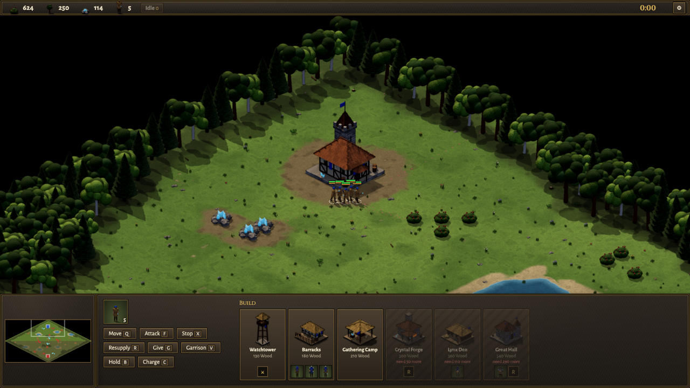
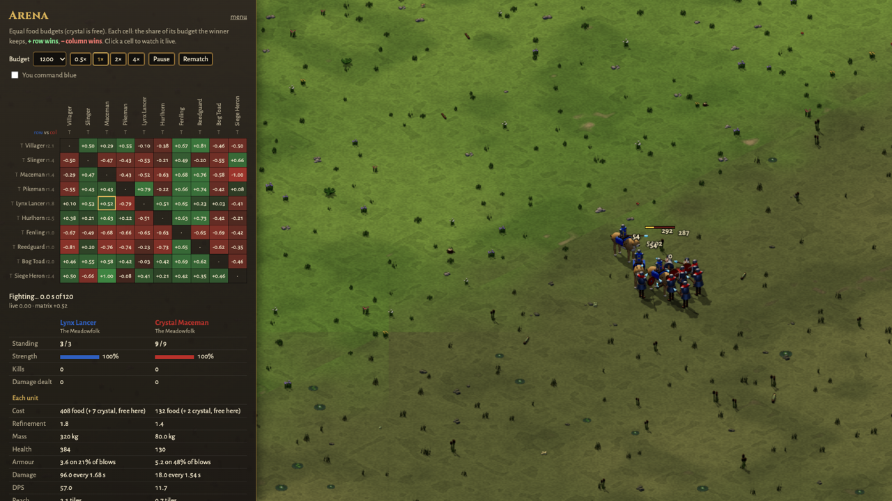
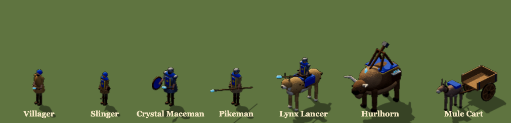
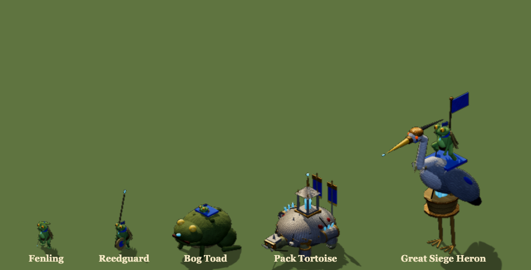

<h1 align="center">VibeCraft</h1>

<p align="center"><b>A browser RTS with ready-made factions, where you can also vibecode your own army, and physics keeps every fight fair.</b></p>

<p align="center">
  <a href="http://mcscope.com/game/vibecraft/"><b>▶ Play it now</b></a> ·
  <a href="http://mcscope.com/game/vibecraft/make.html">Make your army</a> ·
  <a href="#playing">Playing</a> ·
  <a href="#playing-online">Online</a> ·
  <a href="#development">Development</a>
</p>



---

## What makes it different

### 🛡️ Bring your own army
Play one of the shipped factions, or make your own: its units, buildings, techs, art, homeworld and wildlife, usually by vibecoding with an AI. In an online match your faction travels to your opponent as data, and their game checks it against the rules. Any two factions get a fair fight, even ones that have never met.

### ⚖️ Physics keeps it fair
You shape **bodies**, and the engine works out HP, damage, speed and cost. A body is mass, how that mass splits between muscle, frame (bone, shell, plate) and reserve, and the crystal weapon the body swings or throws. The same rules apply to every body:

| | What physics decides |
|---|---|
| **Speed** | Stride comes from leg and body length, so long four-legged bodies gallop, and turn wide. |
| **Blows** | The swing's energy plus the collision of the bodies closing. A couched lance or a set pike takes the whole impact, up to the force at which its pole would buckle. |
| **Armour** | Plate is frame beyond the skeleton, spread over the body's surface. |
| **Throws** | Stones fly real ballistic arcs. |
| **Cost** | Follows the body: a giant hits hard, but it's slow, hungry and expensive. |

Rock-paper-scissors comes straight out of the dynamics: spears beat cavalry, and cavalry runs down infantry and throwers. The **Arena** scores every matchup.



### 🍖 Resources are physical: calories, crystals, carts
- **Calories.** Every body has a calorie tank sized by its mass and reserve. Walking, sprinting and every blow burn it, and a big body moves each kilo more cheaply. An empty unit is exhausted: slow, and unable to fight until it eats. Units eat from their buildings' food stores, packs or food bearers. An army's reach depends on its supply, and a charge has a real cost.
- **Crystals.** Every weapon's business end is crystal. A striker keeps its crystal, but a thrower spends one with every throw, and the spent stones lie where they land as shards anyone can pick up. Towers and garrisons throw from their building's own stock, and ammo bearers carry crystal into the field.
- **Carts.** Resources sit in the building that gathered or received them. Carts and hauling workers move the spare to where it's needed, most urgent first, with your waiting orders first in line. Where you put buildings, and keeping their supply lines open, is part of the strategy.

---

## The factions

Two factions ship with the game. Each is shown below with every unit to scale.

**The Meadowfolk:** farmers and knights of the green country, with crystal maces, pikes, lancers on great lynxes, and the siege beast Hurlhorn.


**The Fenfolk:** frog-folk of the marsh, with slingers, reed-spear guards, ridden bog toads, and a great siege heron.


---

## Playing

Play in the browser at **[mcscope.com/game/vibecraft](http://mcscope.com/game/vibecraft/)**, or run your own copy (see [Development](#development)).

| Mode | What it is |
|---|---|
| **Skirmish** | Build an economy and fight the AI. |
| **Spectate** | Watch two AIs fight it out. |
| **Arena** | Watch any two units fight on an equal budget, with every matchup scored. Tick *You command blue* to fight it yourself. |
| **Proving Grounds** | Command a full army against training dummies and a target fort. |
| **Online game** | 1v1 against a friend, each bringing your own faction. |
| **Codex** / **Unit Lab** | Every faction's tech tree, and how each body turns into stats. |

**Maps:** Woodlands, Steppe (after AoE2's Arabia), Water Donut, Cliff Maze, and Sunken Temple (after StarCraft's Lost Temple). Pick one in the menu; online, the host picks.

**URL shortcuts:** `?mode=skirmish&you=fenfolk&foe=meadowfolk&map=cliff-maze&seed=5`

---

## Making your own army

The in-game guide, **[Make your army](http://mcscope.com/game/vibecraft/make.html)**, walks through it for players. In short:

1. **Dream up your people.** Decide where they live, what they eat, how they fight and what makes them strange. Pick a theme, a playstyle and one or two signature ideas, and skim [DESIGN_SPACE.md](DESIGN_SPACE.md) for abilities waiting for a first faction to use them.
2. **Copy a faction.** Copy `src/factions/fenfolk/` (or `meadowfolk/`) to `src/factions/<yours>/`, then give it a new `id` and `name`.
3. **Register it.** Add it to `PLAYABLE` in `src/factions/index.ts` and to the Codex in `src/codex.ts`.
4. **Shape the bodies** (the table below). Watch the Codex or Unit Lab update as you change them.
5. **Draw them.** Each unit and building has a `model(builder, pose)` built from primitives: boxes, spheres, limbs and joints. The game bakes models into lit isometric sprites.
6. **Bring your land.** `homeworld.ts` sets the look of your half of the map, and `wildlife.ts` lists the animals that roam it.
7. **Test it** in the Arena, Proving Grounds and Skirmish. The AI is generic: it reads your buildings and what they train. `npm test` checks your faction against the rules.

### A unit's body

| Field | What it is |
|---|---|
| `mass` | kg. Bigger is stronger, hungrier, slower to turn and dearer. |
| `physique: { muscle, frame, reserve }` | How the mass splits. Muscle drives speed and blows, frame is health and plate, and reserve is calories. |
| `attack: { style, crystalMass }` | `'strike'` or `'throw'`, and the kg of crystal it swings or throws. Throwers also carry `ammo`. |
| `attack.shaft` | Metres of spear (strikers): adds reach, and impales chargers. |
| `attack.sidearm` | A hand weapon worn beside a shaft, for close in and to the sides. |
| `attack.sling` | Metres of cord (throwers): a lever that speeds light stones up to what the muscle allows. |
| `length` | Metres nose to tail, for a long body that gallops and wheels round. |
| `refinement` | Makes the unit cheaper to train. Buildings and techs raise it. |

`src/factions/types.ts` documents every field.

### Rules of the road
- **A faction is self-contained.** It imports only its own files, and shared helpers from `src/kits/` and `src/biomes/`.
- **Strength comes from the body.** To make something stronger, give it a bigger body or better refinement, and the physics prices it.
- **New behaviour is an engine ability.** Flying, burrowing, healing... add it as a generic, data-defined ability in `src/sim/abilities/` that any faction can switch on, with a validation check and a Codex line.

---

## Playing online

Online games are 1v1. Each player runs their own copy with their own faction. When the match starts, your faction (specs and baked art) travels to your opponent as data, so each player needs only their own code.

1. **Start a relay.** The hosted game's lobby uses `ws://mcscope.com:5190`. To run your own, `npm run relay` starts a tiny WebSocket relay on port 5190. Over the internet, run it somewhere public and use `ws://<host>:5190`, or `wss://` behind TLS if the game is served over https.
2. **Join.** Each player opens **Online game** and enters the relay address, the same room code, a name and a faction. On a LAN, `npm run dev -- --host` lets others reach your copy.
3. **Start.** The first player in the room is the host and presses **Start**.

Both players need the same engine version, because lockstep needs identical rules on both sides.

**Fairness.** Your opponent's client derives every stat and cost from your specs with its own physics, so every unit costs what its body is worth. Everyone starts from the same pool (`START_POOL`). Your starting base and workers are paid out of it, so a grand base means a lean start. The client also sets limits on the few things outside physics, like how much wildlife roams your half. The rules are in `src/sim/fairness.ts`.

**Determinism.** Only commands cross the wire, and every client simulates the same world. Anything nondeterministic in the sim (`Math.random`, wall-clock time, unordered iteration) desyncs a match, so use `world.rng`. `tests/determinism.test.ts` guards this.

---

## Development

```sh
npm install
npm run dev          # http://localhost:5173
npm test             # sim tests (vitest)
npm run typecheck
npm run build        # production build, with the shipped factions' art pre-baked
npm run build:fast   # production build without pre-baking
npm run arena        # print the unit matchup matrix
```

**Pre-baked art.** The game bakes 3D models into sprites in the browser. `npm run build` also bakes the shipped factions (in every team colour) and their lands into `dist/baked/` as WebP pages, so the hosted game loads them instead of baking on every visit. This step takes several minutes and needs Chrome. Custom and online factions still bake on the player's machine, and `npm run dev` always bakes live.

**Dev pages.**
- `?mode=sprites&unit=lynx&anim=attack&facing=3` lays out every frame of one animation.
- `?mode=sprites&faction=fenfolk` shows a faction's roster.

### Layout

| Path | What's there |
|---|---|
| `src/factions/` | Factions: specs, models, homeworld, wildlife. `types.ts` documents every spec field. |
| `src/sim/` | The deterministic simulation: `world.ts`, `physics.ts` (body → stats), `logistics.ts`, `abilities/` |
| `src/ai/` | The skirmish AI (`skirmishAI.ts`) and how it uses abilities (`abilities.ts`) |
| `src/render/`, `src/ui/` | PixiJS renderer, HUD and input |
| `src/kits/bake3d/` | The three.js sprite baker |
| `src/art/` | The art contract, and pre-baked art loading |
| `src/net/` | Lockstep, relay client, faction bundles and their checks |
| `scripts/` | Relay server, arena matrix, pre-baking |
| `tests/` | Sim tests |
